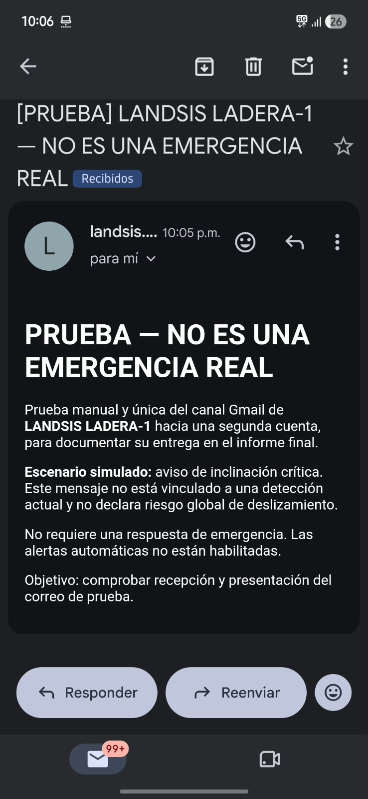

# Prueba controlada Gmail — 3 de noviembre de 2026

El usuario solicitó probar los mensajes de emergencia y eligió como destinataria la misma cuenta Gmail configurada como remitente. Se realizó **un único envío manual**, marcado inequívocamente como simulación. No se configuraron destinatarios externos ni se activaron alertas automáticas.

Se reutilizó Nodemailer y el servicio de correo existente, sin cambios de código, dependencias o configuración. La configuración privada pasó validación: Gmail SMTP, puerto 465 con TLS, remitente igual a la cuenta autenticada. No se publicaron direcciones ni secretos.

Asunto: **[PRUEBA] LANDSIS LADERA-1 — NO ES UNA EMERGENCIA REAL**.

El cuerpo HTML/texto identifica una prueba del canal Gmail, simula un aviso de inclinación crítica sin vincularlo a una lectura actual, aclara que no declara riesgo global de deslizamiento ni requiere respuesta de emergencia y comunica que no hay alertas automáticas habilitadas.

## Resultado

- Verificación de conexión/autenticación SMTP: correcta; sin mensaje durante esa verificación.
- Intentos de envío: **1**.
- Mensaje aceptado por SMTP: **sí**, un destinatario aceptado y ninguno rechazado.
- Reintentos: ninguno.
- El transporte se cerró después de la prueba.
- Confirmación de recepción/presentación en Gmail: solicitada al usuario, pendiente al crear esta nota. La aceptación SMTP no se presenta como prueba de aparición en Recibidos.

**Confirmación final:** el usuario respondió «Sí, llegó y se ve correctamente». Quedan comprobadas autenticación SMTP, aceptación del envío, recepción por la cuenta elegida y presentación correcta del mensaje de prueba. Se mantuvo un único envío; no se activaron alertas automáticas.

## Alcance

Se comprueba el canal de correo, no un sistema de emergencias completo. El backend tiene servicio genérico y correos de recuperación, pero no un disparador de emergencia conectado a la telemetría. No se simuló una medición en la base de datos ni se cambió el estado del nodo para enviar esta prueba.

Integrar alertas automáticas requerirá acordar evento experimental, destinatarios, control de duplicados/reenvíos, recuperación y conducta ante falta de datos. No se debe equiparar automáticamente CRÍTICO de inclinación con riesgo global de deslizamiento. Ese diseño no se implementó en esta prueba.

## Segunda prueba — destinatario Gmail indicado por el usuario

El usuario solicitó repetir la comprobación hacia otra cuenta y proporcionó explícitamente su dirección. Se omite la dirección completa en este documento versionable para evitar publicar datos personales; el destinatario queda identificado como **segunda cuenta Gmail autorizada**, conforme a la conversación de prueba.

| Campo | Evidencia |
| --- | --- |
| Fecha/hora de aceptación | 3 de noviembre de 2026, **22:05:21**, hora de Guatemala; `2026-11-04T04:05:21.331Z` en UTC |
| Destino | Segunda cuenta Gmail indicada por el usuario |
| Canal | Servicio SMTP existente, Gmail puerto 465 con TLS |
| Asunto | [PRUEBA] LANDSIS LADERA-1 — NO ES UNA EMERGENCIA REAL |
| Contenido | HTML y texto; simulación de aviso de inclinación crítica, sin vincularlo a una detección actual ni declarar riesgo global |
| Conexión/autenticación SMTP | Verificada correctamente antes de enviar |
| Intentos | **1**, sin reintentos |
| Aceptación SMTP | **Un destinatario aceptado, ninguno rechazado** |
| Recepción y presentación | **Confirmadas por el usuario y mediante captura de Gmail en Recibidos** |
| Alertas automáticas | Desactivadas; no se cambió la lógica de telemetría ni el semáforo |

Texto para el informe final: «Se realizó una prueba manual controlada del canal de notificación de LANDSIS LADERA-1 hacia una segunda cuenta Gmail autorizada, distinta de la cuenta remitente. La autenticación SMTP, la aceptación del envío y la recepción fueron satisfactorias. Se efectuó un único envío identificado como prueba y sin emergencia real. El destinatario confirmó la recepción y aportó una captura en la que se observa el mensaje en Recibidos, con asunto y contenido HTML legibles en un teléfono móvil. La prueba verifica el canal de entrega y presentación del correo; no valida un disparador automático de emergencia ni una evaluación global del riesgo».

### Evidencia y cierre de la segunda prueba

El usuario confirmó «Llegó correctamente» y aportó la siguiente captura. Se observa la etiqueta **Recibidos**, hora de mensaje **10:05 p. m.**, el asunto de prueba y la presentación del cuerpo en Gmail móvil. La captura se obtuvo a las 10:06 según el reloj visible; no permite determinar latencia exacta en segundos.

Resultado final: **SATISFACTORIO — canal Gmail probado entre dos cuentas distintas**. Se conservaron un solo intento y ninguna alerta automática habilitada. La evidencia y este texto quedan disponibles para incorporar al informe final.

No se modificaron credenciales, firmware, API, base de datos ni configuración de alertas. No se insertó una medición simulada en el sistema y no se enviaron correos adicionales por cambios de estado.
